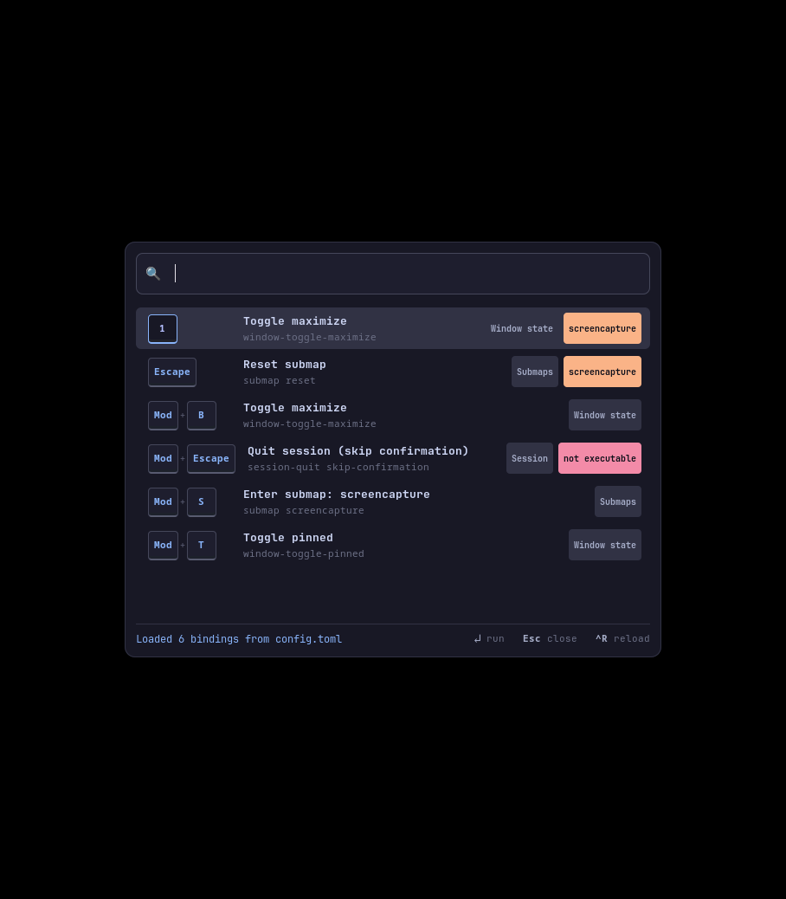
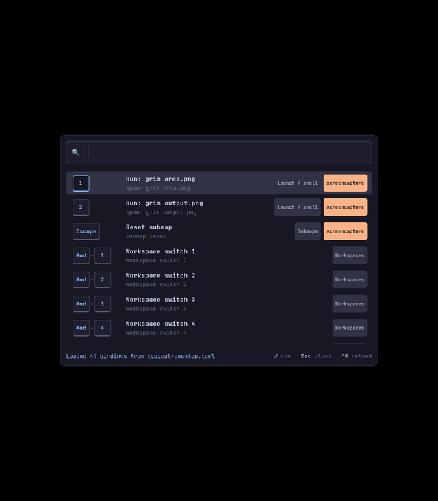

# umbriel-keybind-overlay

An unofficial searchable keyboard-shortcut overlay for the [Umbriel](https://github.com/noctalia-dev/umbriel) Wayland compositor.

> **Notice**: This project is independent and unofficial. It is not affiliated with, endorsed by, or maintained by the Umbriel or Noctalia development team.



## Demo


*Automated walkthrough showing search filtering, modal submap tracking, and action execution in a nested Umbriel session.*

---

## Features

- **Live Config Parsing**: Reads your live Umbriel `config.toml`, merging nested `include` files and tracking modal submaps over IPC.
- **Real-Time Text Search**: Real-time plain text matching across key chords, action commands, titles, submaps, and categories (substring matching; not fuzzy search).
- **Compact Launcher Panel**: Keycap-styled chords, clean action titles, category badges, and an active submap context banner.
- **Responsive Popup Layout**: Width clamps to monitor boundaries; height dynamically fits row content up to a 320px cap, with smooth scrolling for larger sets.
- **Mouse & Pointer Support**: Hover over rows to update selection, single-click to trigger actions, with standard arrow and I-beam cursor fallbacks.
- **Direct Action Execution**: Trigger keybinding actions directly using `Enter` or single-click through a native-session safety gate.

---

## Safety Model

The overlay employs a five-layer defense-in-depth architecture to ensure actions are directed to the correct running Umbriel session:

1. **Process & Config Match**: Identifies the running `umbriel` compositor process matching the target configuration path (supporting both `-c <path>` invocations and default autostart sessions resolving `$XDG_CONFIG_HOME/umbriel/config.toml` from the process's own environment). Execution is refused if zero or multiple instances match. A relative `-c` path is resolved against the compositor's own working directory (`/proc/<pid>/cwd`), not the overlay's; if that directory cannot be established, the candidate is treated as not matching, and the gate refuses unless one unambiguous matching candidate remains. Resolution uses the compositor's current working directory at check time, which can differ from its launch-time directory, so it is best-effort.
2. **Compositor Log Verification**: Reads the running instance's log to confirm identity and extract its active `WAYLAND_DISPLAY`.
3. **Endpoint & Inode Verification**: Confirms that `WAYLAND_DISPLAY` matches the compositor log and verifies that `UMBRIEL_SOCKET` corresponds to an active socket inode owned by an open file descriptor of that exact compositor PID (`/proc/<pid>/fd/`).
4. **Forbidden Action Blocklist**: High-risk action families are strictly excluded from overlay execution:
   - `session-*` (e.g. `session-quit`, logout)
   - `config-*` (e.g. `config-replace`)
   - `output-*` (e.g. `output-destroy`, display toggling)
   - `input-capture-*`
   - `dpms-*` (e.g. `dpms-off`, `dpms-on`)

   Rows matching these families display a `not executable` badge; triggering them displays an advisory warning without touching the session. The blocklist checks only the first word of the configured action: a bare `dpms-off` binding is blocked, while `spawn dpms-off` is not, because its first word is `spawn`. Commands inside `spawn` are never inspected; see No Command Sandboxing below.
5. **Single-Instance Advisory Lock**: Enforces a single instance per Wayland display using an advisory lockfile (`$XDG_RUNTIME_DIR/umbriel-overlay-<display>.lock`) to prevent surface stacking and focus conflicts.

These layers are not equivalent guarantees. Layers 1-3 verify which running Umbriel session the overlay is associated with. Layer 4 restricts which action types may be executed, independently of session identity. Layer 5 only prevents duplicate overlay windows on the same display; it is not an identity check or a security boundary.

### Honest Limitations
- **No Command Sandboxing**: The safety gate verifies the association between the overlay, process, and socket endpoint, but it does **not** sandbox commands. When an executable `spawn` row is triggered, `Enter` runs the command as configured. Only use configurations from sources you trust.
- **Post-Launch `config-replace` Undetectable**: If `umbriel config-replace` is run after compositor startup, the in-memory configuration path change cannot be detected over Umbriel IPC.
- **Cancellation & Process Independence**: Closing the overlay popup (via `Escape` or window destruction) before a pending command is sent cancels execution. However, once a command has been accepted by the compositor or an external process has spawned (such as a terminal), the overlay does not undo the action or kill the spawned application. There is also a small, inherent race window between the final cancellation check and process dispatch.
- **Isolated Launcher Test Harness**: The automated launcher test suite (`tests/test_run_nested.py`) uses fake processes and mock sockets to test script behavior, signal handling, and cleanups in headless environments; it does not exercise a real GPU-backed compositor instance.
- **Advisory Lock Scope**: The single-instance lockfile only coordinates between overlay windows on the same display. It does not verify the identity of the compositor or of other processes and provides no protection against a process that ignores the lock.
- **Relative XDG_CONFIG_HOME or HOME Values**: In the default-launch path, a non-absolute XDG_CONFIG_HOME or HOME in the compositor's environment would be resolved against the overlay's working directory. The XDG Base Directory specification requires XDG_CONFIG_HOME to be absolute and treats relative values as invalid; HOME is outside that specification but is absolute on any normal system, so this affects only non-conforming configurations.

---

## Installation & Prerequisites

### Prerequisites

- **Compositor**: [Umbriel](https://github.com/noctalia-dev/umbriel) (developed and tested against commit `c6ad18d`). Compatibility with other compositors has not been tested.
- **Python Runtime**: Python 3.11+ (no pip packages; GTK3/PyGObject/gtk-layer-shell system packages required).
- **System Packages**:
  - **Fedora**: `sudo dnf install python3 python3-gobject gtk3 gtk-layer-shell`
  - **Debian / Ubuntu**: `sudo apt install python3 python3-gi gir1.2-gtk-3.0 libgtk-layer-shell0 gir1.2-gtklayershell-0.1`
  - **Arch Linux**: `sudo pacman -S python python-gobject gtk3 gtk-layer-shell`
- **Optional Tools**:
  - `grim`: For capturing screenshots.
  - `ffmpeg`: For generating MP4/GIF walkthrough animations.
  - `gcc` + Wayland development headers (Fedora: `wayland-devel`; Debian/Ubuntu: `libwayland-dev`; Arch: `wayland`): For rebuilding the virtual-pointer test tool (`make -C tests`).

---

## Getting the Code

```bash
git clone https://github.com/ayushmishra-18/umbriel-keybind-overlay.git
cd umbriel-keybind-overlay
```

All commands below assume you are running them from this directory.

---

## Quickstart: Safe Nested Session (Recommended)

The easiest and safest way to evaluate the overlay is via the one-command nested launcher from the repository root. Run this from a terminal inside your running graphical Wayland session (for example, inside Hyprland): the nested compositor needs access to the host session's Wayland display. A shell without that environment, such as a headless one, cannot connect.

```bash
./scripts/run-nested.sh
```

This single command:
1. Creates an isolated temporary scratch environment (`/tmp/umbriel-trial.XXXXXX`).
2. Configures nested-session cursor workaround settings (`theme = "Adwaita"`, `size = 24`, and `hardware_cursor = false`) so the mouse pointer remains visible over the nested compositor window.
3. Spawns nested Umbriel with `examples/typical-desktop.toml` on a dedicated Wayland display.
4. Closes the nested session's built-in cheatsheet to prevent overlay occlusion.
5. Launches the keybind overlay popup targeting the nested session.

> [!NOTE]
> - **Modifier Key**: The example config explicitly sets `Mod` to `Super`. The reopen shortcut uses explicit `Alt+Shift+Space`, independent of `Mod`.
> - **Session Persistence & Reopening**: When the overlay closes (after running an action or pressing `Escape`), the nested session and any launched apps (such as terminals) stay alive. Press `Alt+Shift+Space` in the nested window to reopen the overlay. When you are done, press `Enter` in the terminal running `run-nested.sh` to cleanly stop the nested compositor.
> - **Host vs. Nested Clipboard Boundary**: In this nested setup, the nested session's clipboard is separate from the host desktop's clipboard: during testing, text copied on the host did not reach the nested session. To test `Ctrl+V` pasting in the search box, copy text from an application running inside the nested session (e.g. nested terminal via `Ctrl+Shift+C`) or via `wl-copy` within the nested session.

### Controls

- **Type**: Plain text search across key chords, action commands, titles, and categories.
- **`↑` / `↓`** (or **`Ctrl+K` / `Ctrl+J`**): Move selection up and down.
- **Mouse Hover**: Pointer motion over a row moves the selection highlight.
- **`Enter` or Single-Click**: Execute the selected/clicked action and close the overlay.
- **`Escape`**: Close the overlay immediately without executing.
- **`Ctrl+R`**: Reload the configuration from disk.

---

### Manual Nested Session Setup (Appendix)

If you prefer to run each step manually rather than using the launcher script:

#### 1. Launch a Nested Umbriel Session

```bash
# Create an isolated temporary environment
SCRATCH=$(mktemp -d /tmp/umbriel-trial.XXXXXX)
mkdir -p "$SCRATCH/config" "$SCRATCH/cache"

cp "$(pwd)/examples/typical-desktop.toml" "$SCRATCH/config.toml"
cat << 'EOF' >> "$SCRATCH/config.toml"

# Cursor workaround for nested sessions: keeps the pointer visible
# over the nested compositor window.
[input.cursor]
theme = "Adwaita"
size = 24
hardware_cursor = false
EOF

# Start the nested compositor with the typical desktop example
XDG_CONFIG_HOME="$SCRATCH/config" \
XDG_CACHE_HOME="$SCRATCH/cache" \
WLR_BACKENDS=wayland \
umbriel -c "$SCRATCH/config.toml" &
```

A nested Umbriel window will appear on your desktop.

#### 2. Launch the Overlay Against the Nested Session

```bash
# Resolve the nested session's display name
DISPLAY_NAME=""
for i in $(seq 1 50); do
  DISPLAY_NAME=$(grep -h 'running on WAYLAND_DISPLAY=' \
    "$SCRATCH/cache/umbriel/umbriel-stderr.log" \
    "$SCRATCH/cache/umbriel/umbriel.log" 2>/dev/null \
    | tail -1 | sed -n 's/.*WAYLAND_DISPLAY=\(wayland-[0-9]\+\).*/\1/p')
  [ -n "$DISPLAY_NAME" ] && break
  sleep 0.2
done

if [ -z "$DISPLAY_NAME" ]; then
  echo "Nested compositor did not report a display name; check $SCRATCH/cache/umbriel/" >&2
  exit 1
fi

# Close the NESTED session's built-in cheatsheet to prevent overlay occlusion
# (must point at the nested socket, otherwise it targets the host compositor)
UMBRIEL_SOCKET="${XDG_RUNTIME_DIR:-/run/user/$UID}/umbriel-$DISPLAY_NAME.sock" \
umbriel msg cheatsheet-close

# Run the overlay targeting the nested session
WAYLAND_DISPLAY="$DISPLAY_NAME" \
UMBRIEL_SOCKET="/run/user/$UID/umbriel-$DISPLAY_NAME.sock" \
python3 overlay.py -c "$SCRATCH/config.toml"
```

---

## Running on Your Host Session

To run the overlay in your primary Umbriel desktop session:

```bash
python3 overlay.py -c ~/.config/umbriel/config.toml
```

If `-c` is omitted, the overlay automatically resolves `$XDG_CONFIG_HOME/umbriel/config.toml` (falling back to `~/.config/umbriel/config.toml`).

### Configuring a Keybinding in Umbriel

To launch the overlay via shortcut (for example, `Mod+Space`), add this entry to your `config.toml`:

```toml
[keybinds]
"Mod+Space" = { action = "spawn python3 /path/to/umbriel-overlay/overlay.py" }
```

---

## Uninstalling

Cloning and running the overlay installs nothing system-wide - no pip packages and nothing placed in system locations. Any screenshots, logs, or other files you created while testing are separate and are not removed by these steps.

1. **Stop any running overlay and nested sessions** (close the popup, and stop the nested compositor if one is running from `scripts/run-nested.sh`).
2. **Remove your host keybind entry, if you added one.** If you added the `spawn python3 .../overlay.py` entry to your `~/.config/umbriel/config.toml` to launch the overlay with a shortcut, delete that one entry and leave the rest of your configuration unchanged.
3. **Delete the cloned directory.** This also deletes any local changes you made inside it; save anything you want to keep first.
4. **Optionally remove trial scratch directories.** When a nested session from `scripts/run-nested.sh` ends, it prints the exact scratch directory it used (for example `/tmp/umbriel-trial.XXXXXX`) and leaves it in place. You can delete that specific directory once no nested session is running from it - save any screenshots or logs inside it first.

Do not uninstall the prerequisite system packages (Python, GTK 3, gtk-layer-shell, PyGObject): they are shared dependencies that other software on your system may rely on.

---

## Running Tests & Reproducing Tooling

### Test Suites

Run the test suites from the project root:

```bash
# Non-graphical unit tests (requires system GTK packages installed; does not require a display server)
python3 -m unittest tests/test_overlay.py

# Native session integration tests (process association, socket ownership, live window toggle)
python3 -m unittest tests/test_native_session.py

# UI refinement tests (sizing extremes, cursor fallback, hover sync)
python3 -m unittest tests/test_ui_refinement.py

# Launcher behavior tests (fake compositor/overlay processes; headless, no Wayland needed)
python3 -m unittest tests/test_run_nested.py

# Parser fixture tests (compatibility baseline fixtures; headless)
python3 -m unittest tests/test_parser_fixtures.py

# Live session tests (expects an already-running nested Umbriel session; skips cleanly otherwise)
python3 -m unittest tests/test_live_session.py
```

Coverage at a glance (counts grow over time): 110 test methods across 6 suites. CI runs the 95 headless tests (test_overlay, test_run_nested, test_parser_fixtures) on every push. The other suites run locally: test_native_session and test_ui_refinement start their own nested Umbriel session and need the umbriel executable and a host graphical Wayland session (the UI suite also uses the virtual-pointer helper from make -C tests); test_live_session expects an already-running nested session.

### Virtual Pointer Helper

The integration test suite utilizes an in-repo virtual pointer helper (`tests/wlr_ptr`) implementing the `zwlr_virtual_pointer_v1` protocol to generate mouse input. To rebuild it:

```bash
make -C tests
```

---

## Example Configurations

The `examples/` directory contains realistic configurations validated against Umbriel's native syntax:

- **[`examples/minimal.toml`](examples/minimal.toml)** (5 bindings): Core navigation and terminal launching.
- **[`examples/typical-desktop.toml`](examples/typical-desktop.toml)** (44 bindings, 1 submap): Complete daily driver layout with workspaces 1–9, media keys, and a screencapture submap.
- **[`examples/power-user.toml`](examples/power-user.toml)** (58 bindings, 3 submaps): Advanced modal workflow with `screencapture`, `window_mgmt`, and `system` submaps.

---

## Automated Walkthrough Demo

A self-contained automated demonstration script is available in `demo/`:

```bash
cd demo
./demo.sh
```

This script launches an isolated nested session, exercises search and submap features, toggles window states on an active terminal window, and logs window geometry before and after execution. See [`demo/DEMO.md`](demo/DEMO.md) for a narrated walkthrough with screenshots and JSON deltas.

---

## License & Credits

- **License**: Released under the [MIT License](LICENSE) (Copyright 2026 Ayush Mishra).
- **Third-Party Acknowledgments**: See [NOTICE](NOTICE) for third-party acknowledgments, including Umbriel/Noctalia configuration merge semantics and Josef Gajdusek's `wlr-virtual-pointer` protocol files.

---

## Contributing

Contributions, bug reports, and suggestions are welcome. Please read [CONTRIBUTING.md](CONTRIBUTING.md) before submitting pull requests; all submissions are reviewed by the maintainer.
