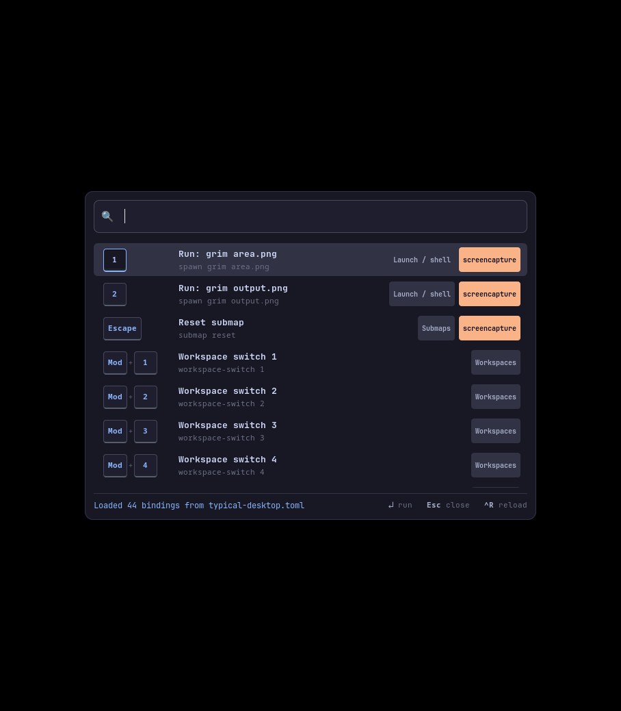
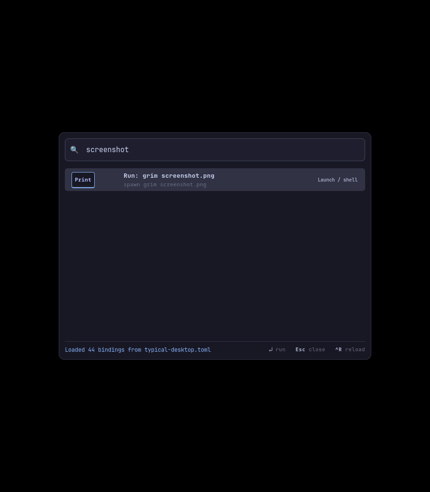
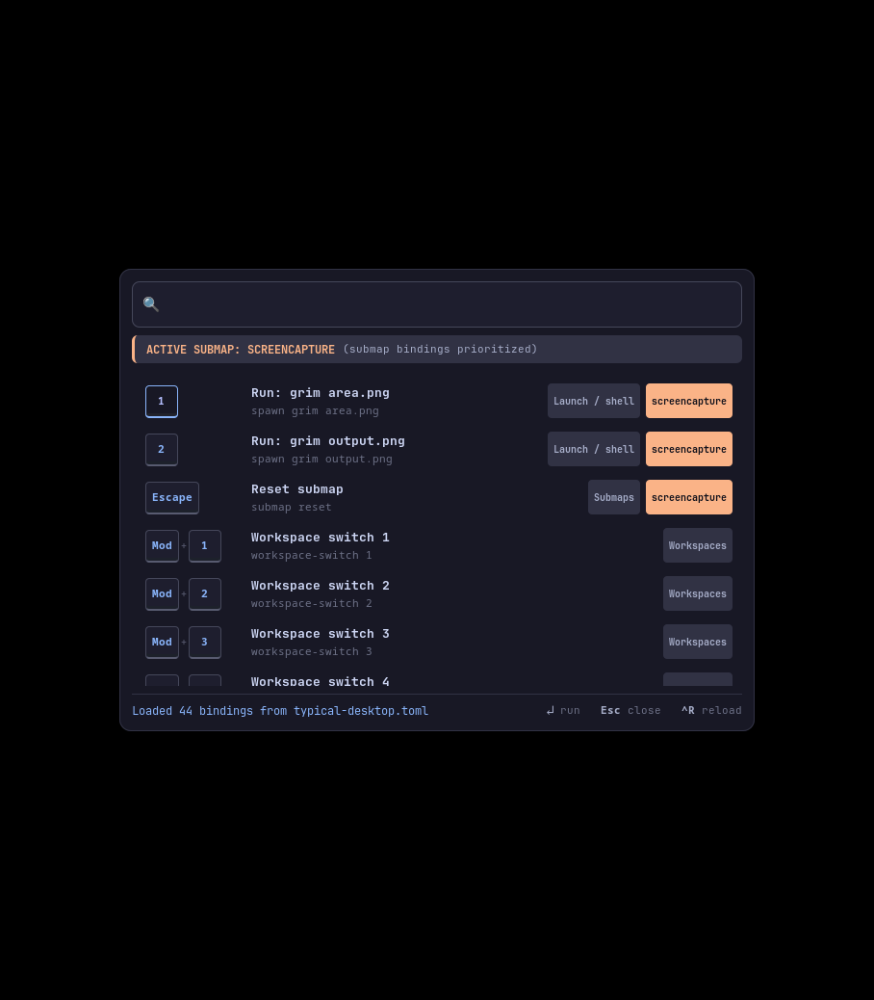
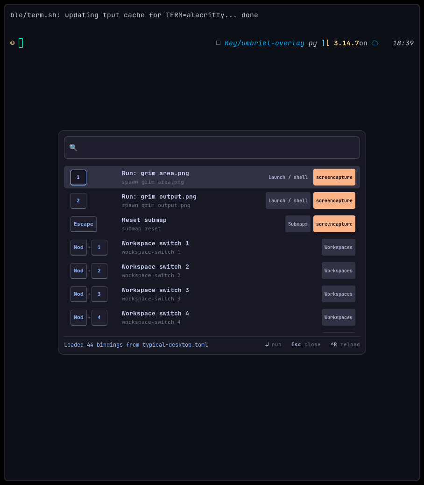

# Umbriel Keybind Overlay: Visual Demo Walkthrough

A quick two-minute walkthrough demonstrating the overlay in an isolated nested Umbriel session running the realistic `examples/typical-desktop.toml` configuration (44 bindings).

---

## 1. Default Launcher View

When invoked, the overlay opens instantly as a centered Wayland layer-shell surface on the `overlay` layer. It grabs keyboard focus exclusively, placing the cursor directly in the search bar.



- **Keycap Badges**: Modifier chords are parsed into visual keycap badges (`[Mod] + [Return]`, `[Mod] + [1]`, `[Print]`, etc.).
- **Readable Titles**: Action strings are translated to human-readable names (e.g. `window-toggle-maximize` becomes "Toggle maximize").
- **Classification Badges**: Actions are categorized (`Window state`, `Focus`, `Workspaces`, `Submaps`), and protected actions display a `not executable` danger badge.

---

## 2. Instant Search & Filtering

Typing filters the bindings list in real time across key chords, action names, and categories.



Querying `"screenshot"` performs literal substring matching across chords, action commands, and labels, isolating the exact matching binding from the 44 total bindings:
- `Print`: `spawn grim screenshot.png` (Direct full screen capture)

---

## 3. Live Submap Context

Umbriel compositors support modal submaps (e.g. screencapturing, window modes, resizing). The overlay subscribes to the compositor's IPC stream (`umbriel subscribe submap`).

When the user enters the `screencapture` submap (via `Mod+S`), the overlay dynamically updates its UI:



- **Submap Banner**: Displays a distinct orange status banner: `ACTIVE SUBMAP: SCREENCAPTURE (submap bindings prioritized)`.
- **Automatic Priority**: Bindings belonging to the active submap context (`1`, `2`, `Escape`) are prioritized to the very top of the results list.
- **Submap Reset on Execution**: Executing member bindings flagged with `submap = "reset"` automatically runs the action and resets the compositor back to the default submap.

---

## 4. Proven Window Control: Toggle Maximize

To verify that the overlay communicates with the real compositor and controls real windows (not just synthetic tests), the demo spawns a terminal (`alacritty`) and triggers `window-toggle-maximize` from the overlay.



### Live Compositor Evidence (`umbriel windows --json`)

#### Before Execution (Normal Tiled Window):
```json
{
  "active": true,
  "app_id": "Alacritty",
  "maximized": false,
  "pinned": false,
  "w": 800,
  "x": 54,
  "y": 10
}
```

#### After Overlay Execution (`window-toggle-maximize`):
```json
{
  "active": false,
  "app_id": "Alacritty",
  "maximized": true,
  "pinned": false,
  "w": 888,
  "x": 10,
  "y": 10
}
```

- **Delta**: `"maximized": true` — the window expanded from `800px` to `888px`, occupying the full column space.

---

## 5. Automated Demo Script

You can re-run this complete demonstration at any time with:

```bash
cd demo
./demo.sh
```

The script runs end-to-end inside an isolated nested session, records all before/after window states in `windows-before-maximize.json` and `windows-after-maximize.json`, captures all screenshots, and (if `ffmpeg` is present) compiles `demo.mp4` and `demo.gif`.
